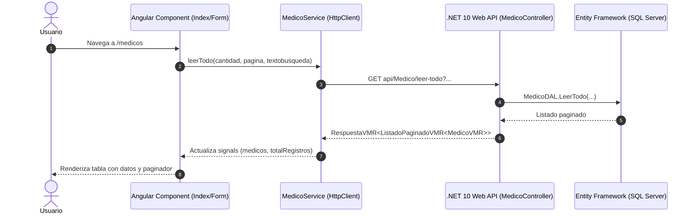

# Procedimiento de Implementación: Integración de Endpoints de Médicos en Angular 21

Este documento describe detalladamente el procedimiento, la arquitectura y los pasos técnicos seguidos para conectar el Frontend en **Angular 21** con la API REST de **Médicos** (.NET 10 Web API) en el sistema de gestión hospitalaria.

---

## 📋 Resumen de la Solución

Se desarrolló una integración completa basada en **Standalone Components**, **Signals** para manejo de estado reactivo, **Angular Material** y **Bootstrap 5.3** para la interfaz visual, y **`ngx-toastr`** para retroalimentación al usuario.



---

## 🛠️ Endpoints Consumidos del Backend (.NET 10)

| Operación | Método HTTP | Ruta Endpoint | Descripción |
| :--- | :--- | :--- | :--- |
| **Listar / Buscar** | `GET` | `/api/Medico/leer-todo` | Obtiene el listado paginado con filtro opcional de búsqueda (`cantidad`, `pagina`, `textobusqueda`). |
| **Consultar Uno** | `GET` | `/api/Medico/{id}` | Recupera la información detallada de un médico por su ID. |
| **Registrar** | `POST` | `/api/Medico` | Da de alta un nuevo médico con validaciones de datos. |
| **Actualizar** | `PUT` | `/api/Medico/{id}` | Modifica los datos de un médico existente. |
| **Eliminar** | `DELETE` | `/api/Medico` | Realiza el borrado lógico de uno o varios médicos pasando un arreglo de IDs en el cuerpo de la petición. |

---

## 🚀 Pasos Seguidos en la Implementación

### Paso 1: Configuración Centralizada de la API
* **Archivo creado:** `src/app/config/api.config.ts`
* **Propósito:** Centralizar la URL base (`http://localhost:5000/api`) y los endpoints para evitar valores estáticos (*hardcoded*) dispersos en el código.

### Paso 2: Modelos e Interfaces TypeScript
* **Archivos creados:**
  * `src/app/models/respuesta.model.ts`: Modela la estructura genérica de respuesta del backend (`RespuestaVMR<T>`) y la paginación (`ListadoPaginadoVMR<T>`).
  * `src/app/models/medico.model.ts`: Define las interfaces `MedicoVMR` (para visualización y edición) y `MedicoCrear` (para el payload de inserción).

### Paso 3: Servicio de Consumo HTTP (`MedicoService`)
* **Archivo creado:** `src/app/services/medico.service.ts`
* **Métodos implementados:**
  * `leerTodo(cantidad, pagina, textobusqueda)`
  * `leerUno(id)`
  * `crear(item)`
  * `actualizar(id, item)`
  * `eliminar(ids: number[])`

### Paso 4: Configuración Global de la Aplicación
* **Archivo modificado:** `src/app/app.config.ts`
* **Proveedores agregados:**
  * `provideHttpClient(withFetch())` para comunicaciones HTTP optimizadas.
  * `provideToastr()` para el sistema global de notificaciones y alertas.

### Paso 5: Layout Principal y Navegación
* **Archivos modificados:** `src/app/app.ts` y `src/app/app.html`
* **Implementación:** Se reemplazó el template genérico de Angular por una barra de navegación (*Navbar*) con Bootstrap y Material Icons que incluye enlaces a los distintos módulos (Médicos, Pacientes, Ingresos, Egresos) y el contenedor `<router-outlet />`.

### Paso 6: Componente del Directorio de Médicos (`Index`)
* **Archivos modificados:** `src/app/modules/medico/components/index/` (`index.ts`, `index.html`, `index.scss`)
* **Funcionalidades:**
  * **Tabla responsiva (`mat-table`)**: Columnas para Selección múltiple, ID, Cédula, Nombre Completo, Especialidad, Estado y Acciones.
  * **Paginación (`mat-paginator`)**: Enlace directo con la paginación del backend con selector de registros por página (5, 10, 25, 50).
  * **Búsqueda reactiva**: Filtro en tiempo real o por botón con capacidad de limpiar el término buscado.
  * **Badges visuales**: Indicadores de estado (*Activo / Inactivo*) y especialidad (*Especialista / Médico General*).
  * **Eliminación individual y masiva**: Cuadros de confirmación y feedback inmediato con Toastr.

### Paso 7: Componente del Formulario de Médicos (`Form`)
* **Archivos modificados:** `src/app/modules/medico/components/form/` (`form.ts`, `form.html`, `form.scss`)
* **Funcionalidades:**
  * **Formulario reactivo (`ReactiveFormsModule`)**: Validaciones alineadas con los metadatos del backend (`[Required]`, `[StringLength]`).
  * **Doble comportamiento (Alta vs Edición)**:
    * Si la ruta incluye `:id`, consulta automáticamente `leerUno(id)` y precarga el formulario.
    * Al presionar guardar, invoca `crear()` o `actualizar(id, data)` según corresponda.
  * **Controles visuales**: Campos con `matInput`, prefijos con iconos de Material y switches con `mat-slide-toggle` para *¿Es Especialista?* y *Estado Habilitado*.

### Paso 8: Enrutamiento
* **Archivo modificado:** `src/app/app.routes.ts`
* **Rutas configuradas:**
  * `/` ➔ Redirección a `/medicos`
  * `/medicos` ➔ Componente `Index` (Directorio)
  * `/medicos/nuevo` ➔ Componente `Form` (Alta)
  * `/medicos/editar/:id` ➔ Componente `Form` (Edición)
  * `**` ➔ Redirección a `/medicos`

### Paso 9: Verificación de Compilación
* Se verificó la compilación del proyecto con `ng build` confirmando 0 errores y 0 advertencias.

---

## 💻 Guía de Ejecución y Pruebas Locales

1. **Iniciar el Backend (.NET 10)**:
   ```bash
   cd Hospital_backend/WebAPI
   dotnet run
   ```
   *La API estará escuchando en `http://localhost:5000` (o Swagger en `http://localhost:5000/swagger`).*

2. **Iniciar el Frontend (Angular 21)**:
   ```bash
   cd Hospital_Frontend
   npm start
   ```
   *La aplicación abrirá en `http://localhost:4200`.*

3. **Flujo de Pruebas**:
   * Accede a `http://localhost:4200/medicos` para ver el listado y paginación.
   * Haz clic en **"Nuevo Médico"** para registrar un profesional.
   * Modifica un registro con el botón **"Editar"** en la tabla.
   * Realiza búsquedas por cédula o nombre en la barra de búsqueda.
   * Prueba la eliminación individual o múltiple con los checkboxes.
